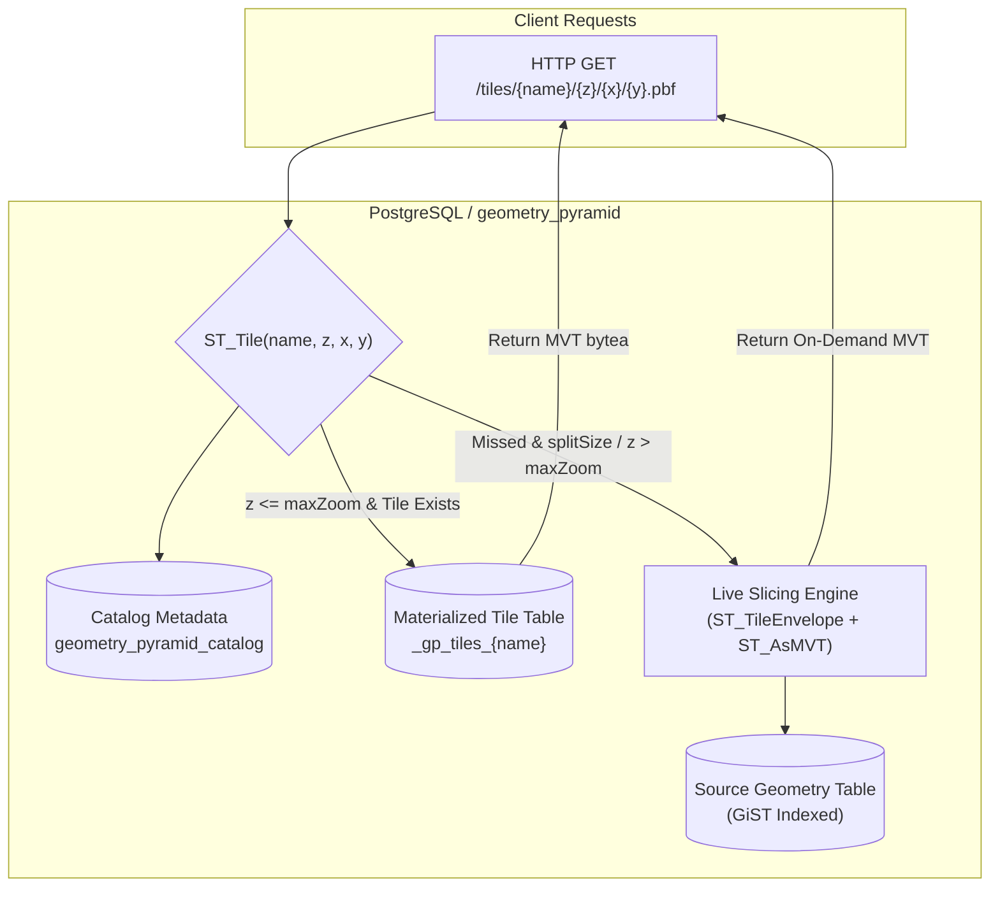

# geometry_pyramid

<p align="center">
  <strong>High-performance PostGIS Vector Tile Pyramid Extension for PostgreSQL</strong>
</p>

<p align="center">
  <a href="README.md">English</a> •
  <a href="README.zh-CN.md">简体中文</a> •
  <a href="#-operations-guide--best-practices">Operations Guide</a> •
  <a href="#️-configuration-reference">Configuration</a> •
  <a href="demo/README.md">Local Demo</a>
</p>

<p align="center">
  
  
  
  
</p>

---

## 📖 Table of Contents

- [💡 Overview & Value Proposition](#-overview--value-proposition)
- [🏗️ Architecture & Slicing Model](#️-architecture--slicing-model)
- [⚡ Quick Start (5 Minutes)](#-quick-start-5-minutes)
- [🛠️ Installation & Building](#️-installation--building)
- [📚 Operations Guide & Best Practices](#-operations-guide--best-practices)
  - [1. Full Pyramid Build](#1-full-pyramid-build)
  - [2. Tile Retrieval & HTTP Service Integration](#2-tile-retrieval--http-service-integration)
  - [3. Incremental Updates & Spatial Extent Refresh](#3-incremental-updates--spatial-extent-refresh)
  - [4. Zoom-level Detail Control (LOD & buildRules)](#4-zoom-level-detail-control-lod--buildrules)
  - [5. Large-Scale Dataset Performance Tuning](#5-large-scale-dataset-performance-tuning)
  - [6. Maintenance & Lifecycle Management](#6-maintenance--lifecycle-management)
  - [7. Upgrading from 0.1.0 to 0.1.1](#7-upgrading-from-010-to-011)
- [⚙️ Configuration Reference](#️-configuration-reference)
- [🖥️ Local Visualization & Verification](#️-local-visualization--verification)
- [❓ FAQ & Troubleshooting](#-faq--troubleshooting)
- [🔒 Security & Privilege Boundaries](#-security--privilege-boundaries)
- [📄 License & Contributing](#-license--contributing)

---

## 💡 Overview & Value Proposition

`geometry_pyramid` is a native PostgreSQL extension powered by [pgrx](https://github.com/pgcentralfoundation/pgrx). It materializes and dynamically serves Mapbox Vector Tiles (MVT / PBF) directly over PostGIS geometry tables inside PostgreSQL.

Its SQL interface is inspired by Alibaba Cloud GanosBase `ganos_geometry_pyramid`.

### Why geometry_pyramid?

1. **Pre-Materialization with Low-Latency Reads**: Slicing hundreds of millions of features on the fly with raw PostGIS `ST_AsMVT` puts heavy CPU strain on databases. `geometry_pyramid` pre-bakes tiles into dedicated storage tables, enabling microsecond-to-millisecond responses via straightforward primary key index lookups.
2. **Hybrid Materialization & Dynamic Slicing**:
   - **Dense Zoom Materialization**: Pre-generate macro zoom levels (e.g., zooms 0 to 14).
   - **Deferred Sparse Tiles (`splitSize`)**: Omit tiles containing fewer features than the threshold, deferring them to live slicing upon request to save up to 80% storage.
   - **Deep Zoom Pass-Through (`dynamicBeyondMaxZoom`)**: Requests beyond `maxZoom` (e.g., zooms 15 to 20) are automatically sliced dynamically from source tables using GiST indexes without infinite pre-materialization.
3. **Surgical Incremental Refresh**:
   - Refresh by SQL attribute filter (`ST_UpdatePyramid`).
   - Refresh by spatial bounding box (`ST_UpdatePyramidByExtent`), reliably cleaning up dirty tiles caused by feature **deletions**, **moves**, or **cross-tile edits**.
4. **Rich Multi-Level of Detail (LOD)**: Fine-grained controls similar to Tippecanoe, including per-zoom SQL filters, attribute trimming, deterministic hash sampling, and screen-pixel point grid clustering.
5. **Zero External Dependencies**: Operates entirely within PostgreSQL. No external tile servers or daemons required (like tegola or tippecanoe), perfectly integrating with standard PostgreSQL transactions and backup tooling.

---

## 🏗️ Architecture & Slicing Model



- **Storage Isolation**: Each pyramid maintains metadata in a central catalog and writes tiles to an isolated table `_gp_tiles_<name>`. Rebuilds happen within a single atomic transaction, preserving published table OIDs, grants, and dependent views.
- **Coordinate Reference Systems**: Output tiles strictly follow Web Mercator (`EPSG:3857`). Source geometries support `EPSG:4326` or any valid SRID specified via `sourceSRS`.

---

## ⚡ Quick Start (5 Minutes)

Run the following SQL to generate and inspect your first vector tile:

```sql
-- 1. Enable extensions
CREATE EXTENSION IF NOT EXISTS postgis;
CREATE EXTENSION IF NOT EXISTS geometry_pyramid;

-- 2. Create sample table (EPSG:4326 Point features)
CREATE TABLE gp_quickstart (
    gid integer PRIMARY KEY,
    name text,
    geom geometry(Point, 4326)
);

INSERT INTO gp_quickstart VALUES 
    (1, 'Central Point', ST_SetSRID(ST_MakePoint(116.4074, 39.9042), 4326)),
    (2, 'Sub Point',     ST_SetSRID(ST_MakePoint(116.4174, 39.9142), 4326));

-- GiST spatial index is strongly recommended
CREATE INDEX gp_quickstart_geom_idx ON gp_quickstart USING gist (geom);

-- 3. Build pyramid (Zooms 0 through 5)
SELECT ST_BuildPyramid(
    'gp_quickstart',                      -- Source table name
    'geom',                               -- Geometry column name
    'gid',                                -- Unique feature ID column
    '{"name": "gp_quickstart", "maxZoom": 5, "attributes": ["name"]}'
);

-- 4. Retrieve tile (Check root tile at 0/0/0)
SELECT octet_length(ST_Tile('gp_quickstart', 0, 0, 0)) AS tile_bytes;

-- 5. Inspect pyramid metadata & statistics
SELECT ST_Pyramid('gp_quickstart');

-- 6. Clean up
SELECT ST_DropPyramid('gp_quickstart');
DROP TABLE gp_quickstart;
```

---

## 🛠️ Installation & Building

The release workflow builds **30 native packages**: PostgreSQL **13–18** on
Ubuntu 24.04 (x86_64 and ARM64), macOS 15 (Intel and Apple Silicon), and Windows
Server 2022 (x86_64). Each job validates the packaged installer, a fresh database,
and an upgrade from 0.1.0 before its artifact can be published. See the
[cross-platform packaging and installation guide](docs/packaging.md) for the
matrix, manual workflow filters, package names, and `pg_config`-based installers.

### Prerequisites

- **Native package targets**: Ubuntu 24.04, macOS 15, Windows Server 2022; see the platform/architecture matrix above
- **PostgreSQL**: 13, 14, 15, 16, 17, 18 (PostgreSQL 17 is the default)
- **PostGIS**: 3.0 or later
- **Toolchain**:
  - Rust stable (installed via rustup; see `rust-toolchain.toml`)
  - `cargo-pgrx` 0.18.0 (`cargo install --locked cargo-pgrx --version 0.18.0`)
  - LLVM / Clang and PostgreSQL development headers (`postgresql-server-dev-17`, `libpq-dev`)
  - Native Windows builds also use the MSVC toolchain; Windows bundle installation uses PowerShell 7+

### Method 1: Development Sandbox Mode

Ideal for local testing and experimentation:

```bash
git clone https://github.com/mapseekai/geometry_pyramid.git
cd geometry_pyramid

# Initialize pgrx against your local pg_config
cargo pgrx init --pg17 $(which pg_config)

# Compile, launch managed PG instance, and enter psql
cargo pgrx run pg17
```

### Method 2: Production Package & Install

Build installable artifacts for an existing PostgreSQL server:

```bash
# 1. Run automated test suite
cargo pgrx test pg17

# 2. Package into output directory
cargo pgrx package --pg-config /usr/lib/postgresql/17/bin/pg_config --out-dir ./dist

# 3. Copy files to PostgreSQL system directory (requires root / sudo)
sudo cp -r ./dist/* /
```

Verify in database:
```sql
CREATE EXTENSION geometry_pyramid;
SELECT geometry_pyramid_version(); -- Returns 0.1.1
```

---

## 📚 Operations Guide & Best Practices

### 1. Full Pyramid Build

Use `ST_BuildPyramid` to create or rebuild a pyramid. If invoked on an existing pyramid name, it performs an **atomic, zero-downtime full rebuild**:

```sql
SELECT ST_BuildPyramid(
    'osm_roads',                  -- Source table (bare identifier, schema prefix not allowed)
    'geom',                       -- Geometry column name
    'id',                         -- Unique primary key column (bigint/integer recommended)
    '{
        "name": "osm_roads_pyr",
        "sourceSRS": 4326,
        "minZoom": 0,
        "maxZoom": 14,
        "attributes": ["name", "highway", "oneway"],
        "tileSize": 4096,
        "tileExtend": 64,
        "parallel": 4,
        "preparedBuild": true
    }'
);
```

> **Operational Tips**:
> - Always run `VACUUM ANALYZE <source_table>;` before building large pyramids.
> - A **GiST index** on the geometry column (`CREATE INDEX ON osm_roads USING gist(geom);`) is essential.
> - Table, column, and pyramid names must be bare ASCII identifiers (up to 45 characters).

---

### 2. Tile Retrieval & HTTP Service Integration

Fetch MVT binary data via `ST_Tile(name, z, x, y)`:

```sql
SELECT ST_Tile('osm_roads_pyr', 12, 3371, 1551);
```

#### Return Value Semantics:
- **`bytea`**: Valid MVT protobuf binary stream.
- **`NULL`**: Empty tile, out of bounds, below `minZoom`, or nonexistent pyramid. Map this to `HTTP 204 No Content` in HTTP services.

#### Node.js / Express Integration Example:

```javascript
app.get('/tiles/:name/:z/:x/:y.pbf', async (req, res) => {
  const { name, z, x, y } = req.params;
  try {
    const query = 'SELECT ST_Tile($1, $2, $3, $4) AS mvt';
    const result = await db.query(query, [name, parseInt(z), parseInt(x), parseInt(y)]);
    const tile = result.rows[0]?.mvt;

    if (!tile || tile.length === 0) {
      return res.status(204).end();
    }

    res.setHeader('Content-Type', 'application/x-protobuf');
    res.setHeader('Cache-Control', 'public, max-age=86400');
    return res.status(200).send(tile);
  } catch (err) {
    return res.status(500).json({ error: err.message });
  }
});
```

---

### 3. Incremental Updates & Spatial Extent Refresh

#### Scenario A: Attribute or existing feature updates (No geometric shift)
Use `ST_UpdatePyramid` with a standard SQL WHERE clause:

```sql
-- Refresh tiles intersecting modified feature IDs
SELECT ST_UpdatePyramid('osm_roads_pyr', 'id IN (1001, 1002, 1003)');

-- Rebuild all tiles seamlessly in place
SELECT ST_UpdatePyramid('osm_roads_pyr', '');
```

#### Scenario B: Feature deletions, geometric moves, or bounding box edits (Recommended)
When features are deleted, attribute predicates cannot find their old positions. Use `ST_UpdatePyramidByExtent` to re-slice intersecting tiles within a bounding box:

```sql
-- Format: ST_UpdatePyramidByExtent(name, xmin, ymin, xmax, ymax, srid)
SELECT ST_UpdatePyramidByExtent(
    'osm_roads_pyr',
    116.35, 39.85, 116.45, 39.95, 4326
);
```

> **Operational Tips**:
> - When features move, the bounding box must enclose **both old and new locations**.
> - Spatial refreshes execute atomically without locking readers.

---

### 4. Zoom-level Detail Control (LOD & buildRules)

At macro zoom levels (e.g. 0 to 6), rendering every raw feature causes bloated tiles and browser lag. Use `buildRules` for per-zoom styling and filtering:

```json
{
  "name": "poi_pyramid",
  "minZoom": 0,
  "maxZoom": 16,
  "attributes": ["name", "category", "rating"],
  "buildRules": [
    {
      "minZoom": 0,
      "maxZoom": 5,
      "filter": "rating >= 4.8",
      "attrFields": ["name"],
      "sample": { "rate": 20, "key": ["gid"] }
    },
    {
      "minZoom": 6,
      "maxZoom": 10,
      "filter": "rating >= 4.0",
      "pointGrid": { "cellPixels": 64, "keepField": "is_landmark" }
    }
  ]
}
```

- **`filter`**: SQL boolean predicate on source table columns (trusted input only).
- **`attrFields`**: Prune unused attributes at lower zoom levels to minimize tile payload.
- **`sample`**: Deterministic hash sampling (0-100%). Ensures consistent feature visibility across zooms without flickering.
- **`pointGrid`**: Screen-pixel bucket clustering. Retains the highest-priority point per pixel bucket, prioritizing features where `keepField` is true.

---

### 5. Large-Scale Dataset Performance Tuning

For multi-million feature datasets, apply the following recommended tuning configuration:

```json
{
  "name": "large_scale_layer",
  "minZoom": 0,
  "maxZoom": 14,
  "parallel": 8,
  "preparedBuild": true,
  "splitSize": 100,
  "featureDrivenEnum": true,
  "simplifyPixels": 1.0,
  "minFeatureSizePixels": 0.5
}
```

1. **`parallel: 4 ~ 16`**: Utilizes PostgreSQL background workers for concurrent zoom-level slicing.
2. **`preparedBuild: true`**: Pre-projects source geometries to Web Mercator (3857), eliminating repetitive coordinate transformations per tile.
3. **`splitSize: 50 ~ 200`**: Omits physical storage of sparse tiles, deferring them to live slicing upon user request.
4. **`featureDrivenEnum: true`**: Directly enumerates impacted tiles from feature bounding boxes instead of scanning the full grid.

---

### 6. Maintenance & Lifecycle Management

#### Catalog Inspection
```sql
-- List all registered pyramids in the database
SELECT * FROM ST_Pyramids();

-- Inspect detailed configuration, zoom statistics, byte sizes, and build timings
SELECT jsonb_pretty(ST_Pyramid('osm_roads_pyr'));
```

#### Dropping Pyramids & Storage Reclaim
```sql
-- Remove pyramid metadata and drop physical storage table _gp_tiles_{name}
SELECT ST_DropPyramid('osm_roads_pyr');
```

> **Warning**:
> - Always execute `ST_DropPyramid` **before** dropping the underlying source table.

---

### 7. Upgrading from 0.1.0 to 0.1.1

Version 0.1.1 binds source and storage tables to concrete database object references (`regclass`), preventing `search_path` hijacking. Execute this in an atomic transaction:

```sql
BEGIN;

ALTER EXTENSION geometry_pyramid UPDATE TO '0.1.1';

-- Update relation bindings (replace with actual schema and table names)
UPDATE public.geometry_pyramid_catalog
SET source_rel = 'public.osm_roads'::regclass,
    storage_rel = 'public._gp_tiles_osm_roads_pyr'::regclass
WHERE pyramid_name = 'osm_roads_pyr';

-- Safety assertion
DO $$
BEGIN
    IF EXISTS (
        SELECT 1 FROM public.geometry_pyramid_catalog 
        WHERE source_rel IS NULL OR storage_rel IS NULL
    ) THEN
        RAISE EXCEPTION 'Upgrade failed: unbound pyramids found; rolling back';
    END IF;
END $$;

COMMIT;
```

---

## ⚙️ Configuration Reference

Supported options for the `config_json` argument in `ST_BuildPyramid`:

| Key | Type | Default | Valid Range | Description |
|---|---|---:|---|---|
| `name` | string | Source table | ≤45 ASCII chars | Pyramid identifier and storage table suffix |
| `sourceSRS` | integer | `4326` | Valid EPSG | Coordinate system of source geometries |
| `tileSRS` | integer | `3857` | `3857` only | Output tile projection (Web Mercator) |
| `minZoom` | integer | `0` | 0 ~ 24 | Minimum materialized zoom level (inclusive) |
| `maxZoom` | integer | `18` | 0 ~ 24 | Maximum materialized zoom level (inclusive); alias `maxLevel` |
| `tileSize` | integer | `4096` | 1 ~ 16384 | Internal MVT coordinate extent |
| `tileExtend` | integer | `8` | 0 ~ tileSize | Buffer around tile edges to prevent edge clipping |
| `attributes` | string[] | `[]` | Array | Source column names to encode into MVT attributes |
| `dynamicBeyondMaxZoom` | boolean | `true` | true / false | Fall back to live slicing when zoom > maxZoom |
| `splitSize` | integer | `0` | ≥ 0 | Sparse tile threshold. 0 materializes all non-empty tiles; >0 defers sparse tiles to live slicing |
| `parallel` | integer | `1` | 0 ~ 32 | Build concurrency (0 = auto, 1 = serial, >1 = worker pool) |
| `preparedBuild` | boolean | `false` | true / false | Pre-transform source geometries before slicing |
| `featureDrivenEnum` | boolean | `false` | true / false | Enumerate candidate tiles from feature bounding boxes |
| `featureMajorPoints` | boolean | `false` | true / false | Accelerated sparse path for pure Point geometries |
| `simplifyPixels` | float | `1.0` | ≥ 0.0 | Geometry simplification tolerance in pixels (0 = off) |
| `minFeatureSizePixels`| float | `0.0` | ≥ 0.0 | Filter out lines/polygons smaller than pixel threshold |
| `dropRate` | float | `1.0` | 0.0 ~ 1.0 | Point retention rate (1.0 = retain 100%) |
| `tileSizeBudgetBytes` | integer | `0` | ≥ 0 | Target uncompressed MVT byte budget (disallows `parallel > 1`) |
| `buildRules` | object[]| `[]` | Array | Per-zoom filtering, attributes, sampling, and point grids |

---

## 🖥️ Local Visualization & Verification

A lightweight testing server with MapLibre GL viewer is provided in `demo/`:

```bash
# 1. Start managed database
cargo pgrx run pg17

# 2. Seed test data and build demo pyramid
export DATABASE_URL="host=localhost port=28817 dbname=geometry_pyramid"
psql "$DATABASE_URL" -v ON_ERROR_STOP=1 -f demo/seed.sql

# 3. Launch HTTP tile server
python3 -m venv .venv && source .venv/bin/activate
pip install "psycopg[binary]"
python3 demo/server.py

# 4. Open in browser
open http://127.0.0.1:8989
```

See [Local Demo Guide (demo/README.md)](demo/README.md) for full instructions.

---

## ❓ FAQ & Troubleshooting

| Symptom | Cause | Solution |
|---|---|---|
| `CREATE EXTENSION` fails | Library missing or PG version mismatch | Rebuild with `cargo pgrx package --pg-config <correct_pg_config>` matching the active server version. |
| `identifier is too long or contains invalid characters` | Identifier exceeds 45 chars or has invalid characters | Ensure table, column, and pyramid names contain only ASCII letters, digits, and underscores. |
| `ST_Tile` returns `NULL` | Empty tile, outside zoom, or live slicing disabled | 1. Verify bounds overlap feature extents;<br/>2. Verify zoom is in `[minZoom, maxZoom]`;<br/>3. Ensure `dynamicBeyondMaxZoom: true` for zoom > maxZoom. |
| Old tiles persist after deletion or move | Cached tiles were not refreshed | Run `ST_UpdatePyramidByExtent(name, xmin, ymin, xmax, ymax, srid)` covering the old feature bounding box. |
| Parallel build rejects `tileSizeBudgetBytes` | Mechanism constraint | Byte budgeting requires serial iterative retries; set `parallel: 1` or disable `tileSizeBudgetBytes`. |
| Live slicing latency is high | Missing spatial index or high concurrency | Create a `GIST(geom)` index on the source table, increase `maxZoom`, or set `splitSize: 0`. |

---

## 🔒 Security & Privilege Boundaries

1. **SQL Injection Guard**: `buildRules[].filter` and `ST_UpdatePyramid(where_clause)` execute arbitrary SQL predicates with the calling database role's permissions. **Never pass untrusted user input directly into these parameters**.
2. **Identifier Whitelisting**: Table and column names are strictly validated against ASCII alphanumeric character sets to prevent DDL/identifier injection.

---

## 📄 License & Contributing

- **License**: Released under the [MIT License](LICENSE).
- **Contributions**: Issues, bug reports, and pull requests are welcome at the [GitHub repository](https://github.com/mapseekai/geometry_pyramid).
