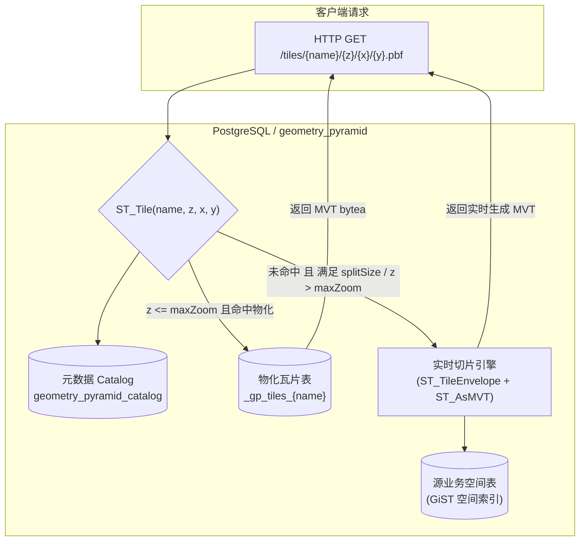

# geometry_pyramid

<p align="center">
  <strong>基于 PostgreSQL / PostGIS 的高性能矢量瓦片金字塔扩展</strong>
</p>

<p align="center">
  <a href="README.md">English</a> •
  <a href="README.zh-CN.md">简体中文</a> •
  <a href="#-操作说明与最佳实践">操作说明</a> •
  <a href="#-配置参数完全参考">配置参考</a> •
  <a href="demo/README.zh-CN.md">本地演示</a>
</p>

<p align="center">
  
  
  
  
</p>

---

## 📖 目录

- [💡 简介与核心价值](#-简介与核心价值)
- [🏗️ 架构与切片机制](#️-架构与切片机制)
- [⚡ 快速上手（5分钟）](#-快速上手5分钟)
- [🛠️ 安装与构建](#️-安装与构建)
- [📚 操作说明与最佳实践](#-操作说明与最佳实践)
  - [1. 全量构建金字塔](#1-全量构建金字塔)
  - [2. 瓦片读取与服务接入](#2-瓦片读取与服务接入)
  - [3. 增量更新与局部空间刷新](#3-增量更新与局部空间刷新)
  - [4. 按层级细节控制（LOD 与 buildRules）](#4-按层级细节控制lod-与-buildrules)
  - [5. 超大数据集构建性能调优](#5-超大数据集构建性能调优)
  - [6. 金字塔维护与生命周期管理](#6-金字塔维护与生命周期管理)
  - [7. 数据库版本升级](#7-数据库版本升级)
- [⚙️ 配置参数完全参考](#️-配置参数完全参考)
- [🖥️ 本地可视化与端到端验证](#️-本地可视化与端到端验证)
- [❓ 常见问题与排障指南](#-常见问题与排障指南)
- [🔒 安全与权限边界](#-安全与权限边界)
- [📄 开源协议与贡献](#-开源协议与贡献)

---

## 💡 简介与核心价值

`geometry_pyramid` 是一个基于 [pgrx](https://github.com/pgcentralfoundation/pgrx) 构建的 PostgreSQL 原生扩展。它能够直接在 PostGIS 几何空间表上构建、持久化物化并按需动态切片 Mapbox Vector Tile (MVT / PBF) 金字塔。

其 SQL 使用接口启发自阿里云 GanosBase 的 `ganos_geometry_pyramid`。

### 为什么选择 geometry_pyramid？

1. **物化存储与低延迟读取**：对于海量要素图层，实时对亿级数据进行 `ST_AsMVT` 往往导致数据库 CPU 满载并响应超时。`geometry_pyramid` 预先将各层级瓦片物化在专属存储表中，请求时直接走单行索引查询，返回纳秒至毫秒级的纯二进制 MVT。
2. **动静结合的弹性切片（Hybrid Slicing）**：
   - **稠密层物化**：对宏观大范围（如 0～14 级）进行预物化。
   - **稀疏延迟生成（`splitSize`）**：对要素数量低于阈值的瓦片不预先物化，请求时自动回退为源表实时切片，节省高达 80% 的存储空间。
   - **大比例尺动态穿透（`dynamicBeyondMaxZoom`）**：超过物化 `maxZoom`（如 15～20 级）的请求自动基于源表空间索引实时切片，无需将数据无限制物化至叶子层。
3. **细粒度局部刷新，告别全量重跑**：
   - 支持基于属性过滤（`ST_UpdatePyramid`）的增量刷新。
   - 支持基于空间范围（`ST_UpdatePyramidByExtent`）的瓦片重切，完美解决要素**删除**、**位移**以及**跨瓦片变更**的脏瓦片清理问题。
4. **精细化多级细节控制（LOD）**：提供类似 Tippecanoe 的逐级控制能力，包括 SQL 过滤、输出属性裁剪、确定性哈希抽样（Sample）以及基于屏幕像素桶的点网格聚类（Point Grid）。
5. **极简运维与标准 SQL**：纯数据库内运行，无需引入外部切片中间件（如 tegola, tippecanoe），完全通过标准 SQL 驱动，天然适配数据库事务与备份生态。

---

## 🏗️ 架构与切片机制



- **存储隔离**：每个金字塔均拥有内部统一管理的元数据，以及独立的物理存储表 `_gp_tiles_<name>`。全量重建在单一事务内以临时行替换，保证发布表 OID、访问权限和依赖视图零中断。
- **投影体系**：瓦片输出严格遵循 Web Mercator（`EPSG:3857`），源数据支持 `EPSG:4326` 或任意有效 SRID（通过 `sourceSRS` 声明）。

---

## ⚡ 快速上手（5分钟）

只需几行 SQL 即可创建并体验你的第一张矢量瓦片：

```sql
-- 1. 启用扩展
CREATE EXTENSION IF NOT EXISTS postgis;
CREATE EXTENSION IF NOT EXISTS geometry_pyramid;

-- 2. 准备测试数据（以 EPSG:4326 点要素为例）
CREATE TABLE gp_quickstart (
    gid integer PRIMARY KEY,
    name text,
    geom geometry(Point, 4326)
);

INSERT INTO gp_quickstart VALUES 
    (1, 'Central Point', ST_SetSRID(ST_MakePoint(116.4074, 39.9042), 4326)),
    (2, 'Sub Point',     ST_SetSRID(ST_MakePoint(116.4174, 39.9142), 4326));

-- 强烈建议在几何列上建立 GiST 空间索引
CREATE INDEX gp_quickstart_geom_idx ON gp_quickstart USING gist (geom);

-- 3. 构建金字塔（构建 0~5 级）
SELECT ST_BuildPyramid(
    'gp_quickstart',                      -- 源表名称
    'geom',                               -- 几何字段名
    'gid',                                -- 唯一要素主键名
    '{"name": "gp_quickstart", "maxZoom": 5, "attributes": ["name"]}'
);

-- 4. 读取瓦片（检查 0 级根瓦片是否有内容）
SELECT octet_length(ST_Tile('gp_quickstart', 0, 0, 0)) AS tile_bytes;

-- 5. 查看金字塔统计信息
SELECT ST_Pyramid('gp_quickstart');

-- 6. 清理资源
SELECT ST_DropPyramid('gp_quickstart');
DROP TABLE gp_quickstart;
```

---

## 🛠️ 安装与构建

发布工作流为 PostgreSQL **15–18** 提供 **20 个原生构建组合**：Ubuntu 24.04
（x86_64 / ARM64）、macOS 15（Intel / Apple Silicon）和 Windows Server 2022
（x86_64）。每个作业验证安装包、首次启用以及从 0.1.0、0.1.2 升级，再汇总发布产物。
构建矩阵、手动筛选、包名和通过目标 `pg_config` 安装的步骤见
[跨平台打包与安装](docs/packaging.md)。

从 **0.1.3** 起不再支持 PostgreSQL 13、14，也不再为它们生成新包。[v0.1.2 原有资产](https://github.com/mapseekai/geometry_pyramid/releases/tag/v0.1.2)保持不变，仅作为历史版本保留，不代表当前支持。旧 PostgreSQL 服务器需先升级到 15–18，再安装 0.1.3。

### 系统与依赖前置要求

- **原生安装包目标**：Ubuntu 24.04、macOS 15、Windows Server 2022；CPU 架构见上方构建矩阵
- **PostgreSQL**：15, 16, 17, 18（推荐并默认启用 17）
- **PostGIS**：3.1 及以上版本，构建时启用 MVT/protobuf 支持
- **编译工具链**：
  - Rust stable（通过 rustup 安装，版本通道见 `rust-toolchain.toml`）
  - `cargo-pgrx` 0.18.0（`cargo install --locked cargo-pgrx --version 0.18.0`）
  - LLVM / Clang（pgrx 编译依赖）及对应 PG 的开发头文件（`libpq-dev`, `postgresql-server-dev-17` 等）
  - Windows 原生编译使用 MSVC 工具链，安装包脚本使用 PowerShell 7+

### 方式一：开发调试模式（一键启动沙箱）

适合本地开发或快速功能验证：

```bash
git clone https://github.com/mapseekai/geometry_pyramid.git
cd geometry_pyramid

# 初始化 pgrx 并绑定系统中的 pg_config（以 PG17 为例）
cargo pgrx init --pg17 $(which pg_config)

# 编译并启动测试 PostgreSQL 实例并自动进入 psql
cargo pgrx run pg17
```

### 方式二：生产编译打包安装

将编译好的扩展产物分发至已有生产实例：

```bash
# 1. 运行自动化单元与回归测试
cargo pgrx test pg17

# 2. 编译并输出标准化安装包
cargo pgrx package --pg-config /usr/lib/postgresql/17/bin/pg_config --out-dir ./dist

# 3. 将产物安装到 PostgreSQL 系统目录（需要 root / sudo 权限）
sudo cp -r ./dist/* /
```

在数据库中验证安装版本：
```sql
CREATE EXTENSION geometry_pyramid;
SELECT geometry_pyramid_version(); -- 返回 0.1.3
```

---

## 📚 操作说明与最佳实践

### 1. 全量构建金字塔

调用 `ST_BuildPyramid` 创建金字塔。若对已存在的金字塔重新执行，扩展会在**独立事务中自动安全全量重建**：

```sql
SELECT ST_BuildPyramid(
    'osm_roads',                  -- 源表名（必须是裸标识符，不支持 schema 前缀）
    'geom',                       -- 几何字段名
    'id',                         -- 唯一主键字段名（强烈建议 bigint / integer）
    '{
        "name": "osm_roads_pyr",
        "sourceSRS": 4326,
        "minZoom": 0,
        "maxZoom": 14,
        "attributes": ["name", "highway", "oneway"],
        "tileSize": 4096,
        "tileExtend": 64,
        "parallel": 4,
        "preparedBuild": true
    }'
);
```

> **操作提示**：
> - 空间数据导入或大量更新后，请先 `VACUUM ANALYZE <source_table>;` 再执行金字塔构建。
> - 几何字段必须建有 **GiST 索引**（`CREATE INDEX ON osm_roads USING gist(geom);`）。
> - 表名、字段名和金字塔名最长支持 45 字节 ASCII 字符。

---

### 2. 瓦片读取与服务接入

通过 `ST_Tile(name, z, x, y)` 获取指定瓦片的 MVT 二进制数据（`bytea`）。

```sql
-- 查询 z=12, x=3371, y=1551 的瓦片
SELECT ST_Tile('osm_roads_pyr', 12, 3371, 1551);
```

#### 返回值规范：
- **`bytea`（二进制字节流）**：瓦片包含有效几何要素，直接返回 MVT 编码。
- **`NULL`**：空瓦片、超出范围、层级低于 `minZoom` 或金字塔不存在。在 HTTP 服务层应转换为 `HTTP 204 No Content`。

#### 生产 HTTP 服务接入示例（Node.js / Express / pg）：

```javascript
app.get('/tiles/:name/:z/:x/:y.pbf', async (req, res) => {
  const { name, z, x, y } = req.params;
  try {
    const query = 'SELECT ST_Tile($1, $2, $3, $4) AS mvt';
    const result = await db.query(query, [name, parseInt(z), parseInt(x), parseInt(y)]);
    const tile = result.rows[0]?.mvt;

    if (!tile || tile.length === 0) {
      return res.status(204).end();
    }

    res.setHeader('Content-Type', 'application/x-protobuf');
    res.setHeader('Content-Encoding', 'gzip'); // 若外部配置压缩
    res.setHeader('Cache-Control', 'public, max-age=86400');
    return res.status(200).send(tile);
  } catch (err) {
    return res.status(500).json({ error: err.message });
  }
});
```

---

### 3. 增量更新与局部空间刷新

当源数据发生变化时，无需每一次都全量重构金字塔，利用增量刷新可以在毫秒至秒级更新受影响瓦片。

#### 场景 A：已知要素主键/属性发生修改（要素未发生大范围位移）
使用 `ST_UpdatePyramid` 并传入合法的 SQL WHERE 条件：

```sql
-- 仅刷新指定 ID 对应要素所跨越的瓦片
SELECT ST_UpdatePyramid('osm_roads_pyr', 'id IN (1001, 1002, 1003)');

-- 刷新某行政区内的修改
SELECT ST_UpdatePyramid('osm_roads_pyr', "city = 'Beijing'");

-- 若传入空字符串 ''，则执行全量瓦片无缝重建
SELECT ST_UpdatePyramid('osm_roads_pyr', '');
```

#### 场景 B：要素发生删除、位移或跨瓦片大范围变更（强烈推荐）
当要素被 `DELETE` 时，源表中已不存在旧要素，单纯通过属性条件无法定位“旧位置”上的瓦片。此时使用 `ST_UpdatePyramidByExtent` 按空间包围盒精准重切：

```sql
-- 格式：ST_UpdatePyramidByExtent(name, xmin, ymin, xmax, ymax, srid)
-- 示例：刷新北京核心区（包含旧位置和新位置的 BBOX）
SELECT ST_UpdatePyramidByExtent(
    'osm_roads_pyr',
    116.35, 39.85, 116.45, 39.95, 4326
);
```

> **操作提示**：
> - 几何发生位移（Move/Update geometry）时，BBOX 必须同时包络**变更前位置**与**变更后位置**。
> - 空间刷新在独立事务中完成脏瓦片替换，刷新期间读请求平滑不阻塞。

---

### 4. 按层级细节控制（LOD 与 buildRules）

在低缩放层级（如 0~6 级），若展示全部要素会导致单瓦片体积膨胀、浏览器卡顿。通过 `buildRules` 实现类似制图规则的精细化抽稀与过滤：

```json
{
  "name": "poi_pyramid",
  "minZoom": 0,
  "maxZoom": 16,
  "attributes": ["name", "category", "rating"],
  "buildRules": [
    {
      "minZoom": 0,
      "maxZoom": 5,
      "filter": "rating >= 4.8",
      "attrFields": ["name"],
      "sample": { "rate": 20, "key": ["gid"] }
    },
    {
      "minZoom": 6,
      "maxZoom": 10,
      "filter": "rating >= 4.0",
      "pointGrid": { "cellPixels": 64, "keepField": "is_landmark" }
    }
  ]
}
```

- **`filter`**：针对源字段的 SQL 过滤条件表达式（仅限受信任管理员配置）。
- **`attrFields`**：按层级动态裁剪 MVT 携带的属性字段，有效缩减低级别瓦片尺寸。
- **`sample`**：确定性哈希抽样（0~100 百分比）。基于 `key` 字段进行确定性哈希，确保同一要素在不同缩放层级显示具有连贯性，避免缩放抖动。
- **`pointGrid`**：屏幕像素网格聚合。在每个 `cellPixels`（如 64x64 像素）网格内仅保留优先级最高的点，若存在 `keepField` 标记为 true 的关键要素，则优先保留。

---

### 5. 超大数据集构建性能调优

针对数千万至数亿级空间数据，推荐启用以下组合配置以获得最佳构建吞吐：

```json
{
  "name": "large_scale_layer",
  "minZoom": 0,
  "maxZoom": 14,
  "parallel": 8,
  "preparedBuild": true,
  "splitSize": 100,
  "featureDrivenEnum": true,
  "simplifyPixels": 1.0,
  "minFeatureSizePixels": 0.5
}
```

1. **`parallel: 4 ~ 16`**：启用 PostgreSQL 后台 Worker 进行并发分层切片，充分利用多核 CPU。
2. **`preparedBuild: true`**：构建开始前预先将源数据按 Web Mercator（3857）转换并投影物化，避免每一层每个瓦片重复进行昂贵的高斯/墨卡托坐标投影换算。
3. **`splitSize: 50 ~ 200`**：稀疏延迟切片门槛。对于野外、沙漠等要素密度极低的边缘瓦片，不进行物理写入，由前端命中时走实时切片，大幅减少存储占用与 I/O 开销。
4. **`featureDrivenEnum: true`**：直接由要素空间包围盒枚举命中的有效瓦片网格，而非遍历整网格空间做相交检测，对空间分布不均匀的数据集提速尤为显著。

---

### 6. 金字塔维护与生命周期管理

#### 巡检已注册金字塔
```sql
-- 列出当前库内所有已构建金字塔元数据
SELECT * FROM ST_Pyramids();

-- 查看单个金字塔的详细配置、逐层瓦片统计、存储字节数与构建耗时
SELECT jsonb_pretty(ST_Pyramid('osm_roads_pyr'));
```

#### 销毁金字塔与回收存储
```sql
-- 彻底删除指定金字塔及其内部物化瓦片表 _gp_tiles_{name}
SELECT ST_DropPyramid('osm_roads_pyr');
```

> **注意事项**：
> - 在对源业务表执行 `DROP TABLE` 前，**务必先调用 `ST_DropPyramid`** 清理金字塔关系。

---

### 7. 数据库版本升级

先停止正在执行的扩展任务，安装匹配的 0.1.3 安装包并重新建立数据库连接，再分别升级各业务库。Windows 下替换已加载的 DLL 前需停止 PostgreSQL 服务。

在 PostgreSQL 15–18 上，已有 **0.1.1 或 0.1.2** 数据库无需补写元数据或重建瓦片：

```sql
ALTER EXTENSION geometry_pyramid UPDATE TO '0.1.3';
SELECT geometry_pyramid_version(); -- 返回 0.1.3
```

从 **0.1.0** 升级至 0.1.3 时，会依次执行 0.1.1、0.1.2、0.1.3 的升级脚本。0.1.1 增强了元数据中对源表与存储表的物理关系对象绑定（`regclass`），避免跨 schema 或 `search_path` 污染风险。请在维护窗口内按事务执行：

```sql
BEGIN;

-- 1. 更新扩展定义
ALTER EXTENSION geometry_pyramid UPDATE TO '0.1.3';

-- 2. 补齐物理对象绑定（将 schema 与表名替换为实际值）
UPDATE public.geometry_pyramid_catalog
SET source_rel = 'public.osm_roads'::regclass,
    storage_rel = 'public._gp_tiles_osm_roads_pyr'::regclass
WHERE pyramid_name = 'osm_roads_pyr';

-- 3. 安全断言校验（确保无遗漏孤儿记录）
DO $$
BEGIN
    IF EXISTS (
        SELECT 1 FROM public.geometry_pyramid_catalog 
        WHERE source_rel IS NULL OR storage_rel IS NULL
    ) THEN
        RAISE EXCEPTION '升级失败：存在未完成物理关系绑定的金字塔，已自动回滚';
    END IF;
END $$;

COMMIT;
```

---

## ⚙️ 配置参数完全参考

调用 `ST_BuildPyramid(table, geom, fid, config_json)` 时，`config_json` 支持如下参数：

| 参数名 | 类型 | 默认值 | 取值范围 | 说明 |
|---|---|---:|---|---|
| `name` | string | 源表名 | ≤45 ASCII 字符 | 金字塔唯一标识及物理存储表命名后缀 |
| `sourceSRS` | integer | `4326` | 任意有效 EPSG | 源几何坐标系 SRID，需与源表实际定义一致 |
| `tileSRS` | integer | `3857` | 仅 `3857` | 目标瓦片坐标系，当前仅支持 Web Mercator |
| `minZoom` | integer | `0` | 0 ~ 24 | 金字塔物化起始层级（包含） |
| `maxZoom` | integer | `18` | 0 ~ 24 | 金字塔物化终止层级（包含）；别名 `maxLevel` |
| `tileSize` | integer | `4096` | 1 ~ 16384 | MVT 内部矢量坐标网格大小（Extent） |
| `tileExtend` | integer | `8` | 0 ~ tileSize | 瓦片四周外扩 Buffer 像素大小，防止切片接缝处图标与注记被裁剪 |
| `attributes` | string[] | `[]` | 数组 | 写入 MVT Feature 属性表的源表字段名列表 |
| `dynamicBeyondMaxZoom` | boolean | `true` | true / false | 请求层级超出 `maxZoom` 时是否允许实时切片兜底 |
| `splitSize` | integer | `0` | ≥ 0 | 稀疏瓦片延迟切片阈值。0 表示物化所有非空瓦片；>0 时要素数低于该值的瓦片改为请求时实时生成 |
| `parallel` | integer | `1` | 0 ~ 32 | 构建并发度。1 为单进程串行；0 为系统自动判定；>1 启动后台 Worker 并发构建 |
| `preparedBuild` | boolean | `false` | true / false | 切片前是否预先投影并物化源数据，推荐大数据集开启 |
| `featureDrivenEnum` | boolean | `false` | true / false | 是否启用基于要素包围盒的瓦片网格枚举（需 `preparedBuild: true`） |
| `featureMajorPoints` | boolean | `false` | true / false | 针对海量纯 POINT 图层的稀疏按要素切片路径 |
| `simplifyPixels` | float | `1.0` | ≥ 0.0 | 几何抽稀容差像素值。0 表示关闭简化 |
| `minFeatureSizePixels`| float | `0.0` | ≥ 0.0 | 过滤过小线段与微小多边形的像素阈值 |
| `dropRate` | float | `1.0` | 0.0 ~ 1.0 | 基础点抽稀保留率（1.0 为保留 100%） |
| `tileSizeBudgetBytes` | integer | `0` | ≥ 0 | 单瓦片未压缩体积预算上限（字节），超出时触发自适应抽稀重试（不可与 `parallel > 1` 共用） |
| `buildRules` | object[]| `[]` | 规则数组 | 逐层级精细化过滤、采样与网格控制规则（见操作说明第4节） |

---

## 🖥️ 本地可视化与端到端验证

仓库内置了基于 Python 与 MapLibre GL 的轻量端到端预览环境（位于 `demo/` 目录）：

```bash
# 1. 运行 pgrx 环境
cargo pgrx run pg17

# 2. 在另一个终端执行 demo 数据注入（自动构建点数据集与金字塔）
export DATABASE_URL="host=localhost port=28817 dbname=geometry_pyramid"
psql "$DATABASE_URL" -v ON_ERROR_STOP=1 -f demo/seed.sql

# 3. 启动本地瓦片服务
python3 -m venv .venv && source .venv/bin/activate
pip install "psycopg[binary]"
python3 demo/server.py

# 4. 浏览器访问验收
open http://127.0.0.1:8989
```

详细操作说明与前后端联调可直接查阅：[本地演示操作说明 (demo/README.zh-CN.md)](demo/README.zh-CN.md)。

---

## ❓ 常见问题与排障指南

| 常见症状 | 根本原因分析 | 推荐解决方案 |
|---|---|---|
| `CREATE EXTENSION` 提示找不到库文件 | 编译架构或 PG 主版本不匹配 | 检查 `pg_config` 路径，确保使用与目标 PostgreSQL 主版本一致的环境重新 `cargo pgrx package` 并安装。 |
| 构建提示 `identifier is too long or contains invalid characters` | 名称超过 45 字节或含非法字符 | 检查表名、几何列名或金字塔名称，仅允许使用 ASCII 字母、数字和下划线，暂不支持带 schema 的源表名。 |
| `ST_Tile` 始终返回 `NULL` | 瓦片为空、未物化且未开启实时切片 | 1. 检查坐标范围是否与实际数据重叠；<br/>2. 确认请求 zoom 是否在 `[minZoom, maxZoom]` 内；<br/>3. 若 z > maxZoom，确认是否未设置 `dynamicBeyondMaxZoom: false`。 |
| 数据更新/删除后地图上仍存在旧瓦片 | 瓦片未被刷新或仅按未匹配的属性条件刷新 | 对涉及变动的空间矩形范围执行 `ST_UpdatePyramidByExtent(name, xmin, ymin, xmax, ymax, srid)`，确保包含旧要素位置。 |
| 并行构建报错 `tileSizeBudgetBytes cannot be used with parallel > 1` | 机制约束 | 字节预算迭代机制要求确定性重试，请将 `parallel` 设为 `1` 或将 `tileSizeBudgetBytes` 设为 `0`。 |
| 实时动态切片查询较慢 | 源表缺少空间索引或并发压力大 | 1. 确保源表创建了 `GIST(geom)` 索引；<br/>2. 调大 `maxZoom` 预物化更多层级；<br/>3. 设置 `splitSize: 0` 减少延迟切片。 |

---

## 🔒 安全与权限边界

1. **SQL 注入防范**：`buildRules[].filter` 与 `ST_UpdatePyramid(name, where_clause)` 会直接在数据库内核中以当前调用者的数据库角色权限拼装执行。**严禁直接将前端用户输入的未经脱敏的原始文本传入上述参数**，必须仅作为后台受信任管理员配置。
2. **对象标识符安全**：源表名、列名和金字塔名会被严格校验为合法的 ASCII 裸标识符，有效阻断通过表名注入的风险。

---

## 📄 开源协议与贡献

- **开源许可**：本项目基于 [MIT License](LICENSE) 许可协议开放开源。
- **问题反馈与贡献**：欢迎提交 Issue、功能建议与 Pull Request 至 [GitHub 仓库](https://github.com/mapseekai/geometry_pyramid)。
